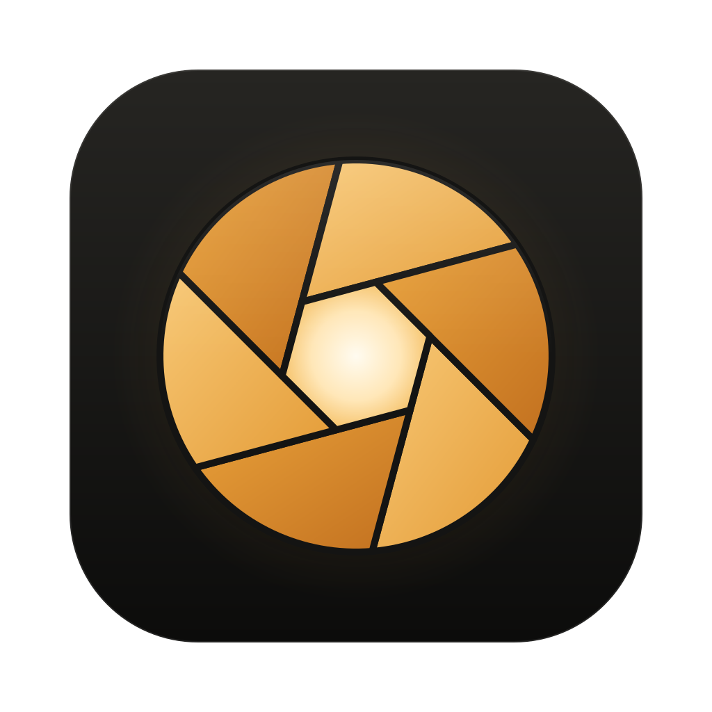
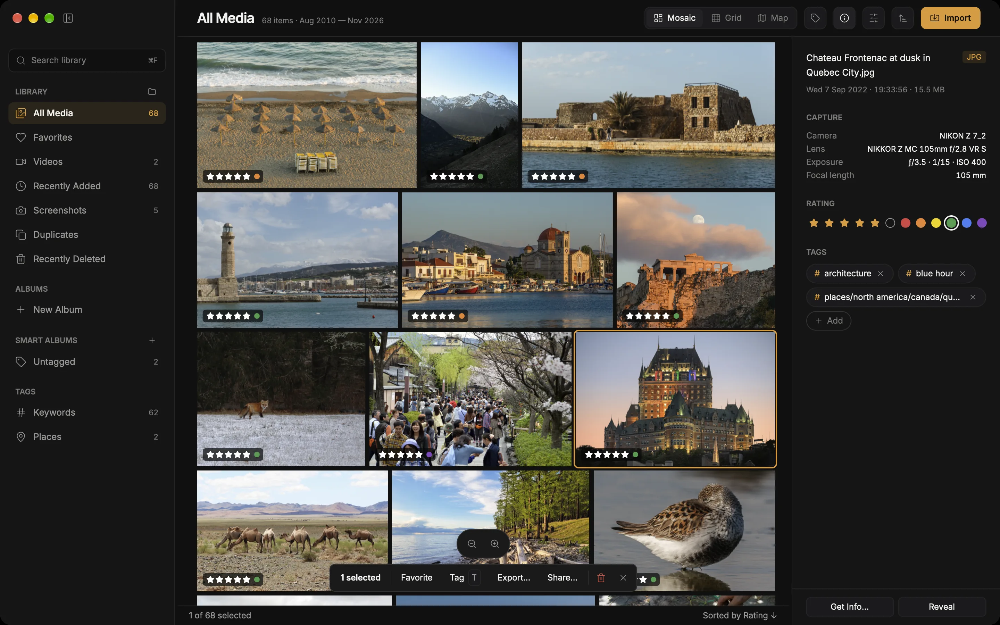
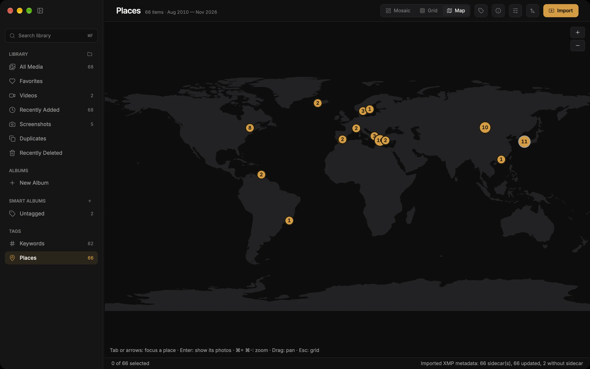
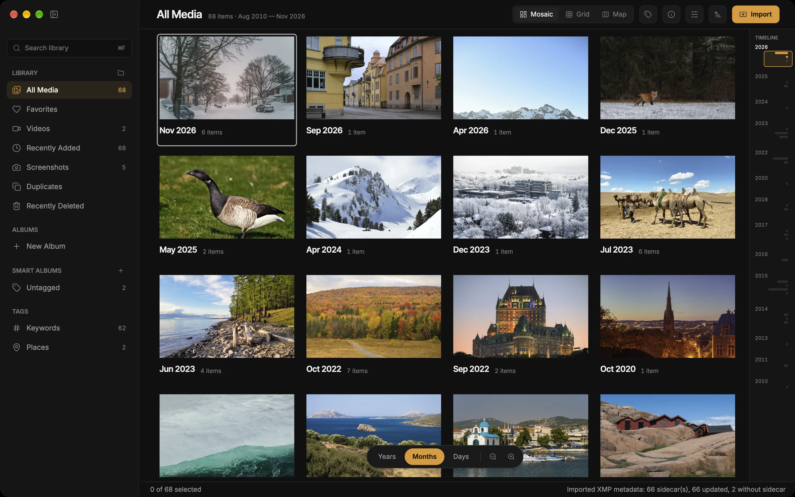
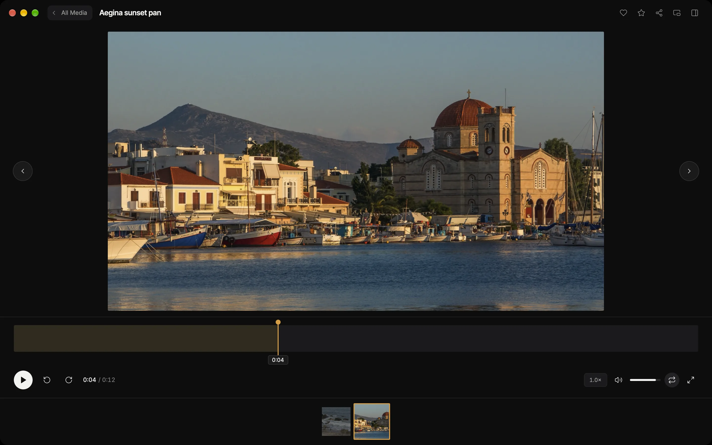
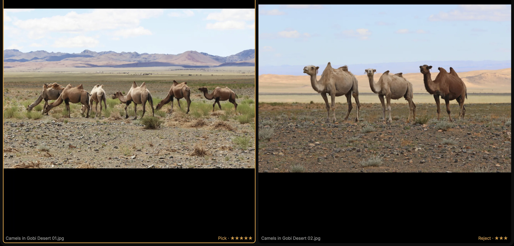
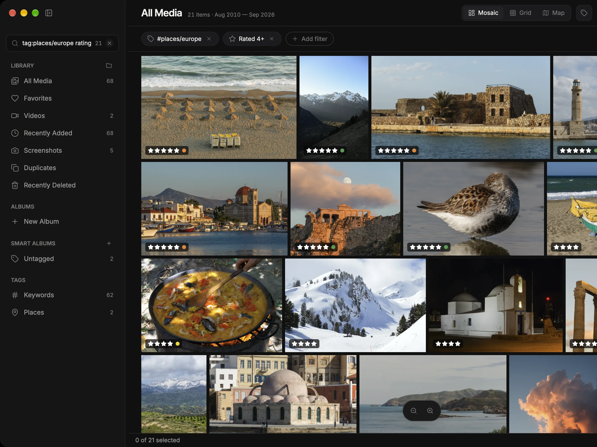

<p align="center">
  
</p>

<h1 align="center">Lumina</h1>

<p align="center">
  <strong>Your photos and videos, on your computer, and nowhere else.</strong><br>
  A fast, native media manager with no account, no cloud and no telemetry.
</p>

<p align="center">
  <a href="https://github.com/raysca/lumina/releases/latest"><strong>Download</strong></a> ·
  <a href="https://raysca.github.io/lumina/">Website</a> ·
  <a href="docs/features.md">All features</a> ·
  <a href="ROADMAP.md">Roadmap</a>
</p>

<p align="center">
  <a href="https://github.com/raysca/lumina/actions/workflows/ci.yml"></a>
  
  <a href="LICENSE"></a>
  
</p>

<p align="center">
  
</p>

---

Lumina is a media manager for people who want to own their photo and video
library. Your photos and videos stay in ordinary folders on your disk. Your ratings, keywords and
captions travel with them in standard, Adobe-compatible XMP sidecars that
Lightroom and other photo tools understand. There is no sign-in, no sync and nothing running in the
background that talks to the internet. It is built in Rust on
[GPUI](https://github.com/zed-industries/zed/tree/main/crates/gpui), the engine
behind the Zed editor, so it stays smooth on libraries of any size.

**Free and open source under the MIT licence. Runs on macOS and Linux. Windows is planned.**

## Why Lumina

### 🔒 Private by design

No account, no telemetry, no analytics, no crash uploads. Places, maps and
reverse geocoding all work offline: the world map is drawn from a bundled
outline and the geocoder is built in, so no tile server ever learns where your
photos were taken. Lumina only goes online when you ask it to (see
[what Lumina sends over the network](#what-lumina-sends-over-the-network)).



### ⚡ Fast and native

A virtualized grid that scrolls at up to 120 FPS on ProMotion displays, Mosaic
and Years / Months / Days browsing, and a viewer with instant zoom, pan and 1:1
pixel inspection. Decoding, cataloguing and search run in a headless core, so
the interface never waits on your disk.



### 🎬 Video, built in

Videos sit beside your photos in the same timeline, albums and searches.
Playback is native, with adjustable speed, frame stepping, loop ranges,
real-frame scrub previews, chapters, alternative audio tracks and
Picture-in-Picture. Paste a link from YouTube, another video site or an HLS
stream and Lumina imports it into your library, with a downloads queue. See
[Import Video from URL](docs/network-import.md).



### 🎯 Cull a shoot from the keyboard

`P` pick, `X` reject, `0`–`5` rate, and move on. Compare 2 to 9 shots side by
side with one shared zoom, review RAW + JPEG pairs and bursts as similar-shot
stacks, then send the rejects to the Trash in one step. Every action is in the
`⌘K` command palette, and almost everything can be undone.



### 🔎 Find anything

Full-text search across file names, folders, places, cameras, lenses, tags and
captions, plus filters you can combine:

```text
camera:Sony iso:>800 city:Kyoto rating:>=4 is:pick
```

Build smart albums from rules (camera, lens, date, rating, place and more) with
a live count and preview.
Keywords can be hierarchies (`places/japan/kyoto`) with aliases. See the
[search syntax](docs/search.md).



### 📦 Your metadata, portable forever

Lumina never modifies your originals. Ratings, colour labels, keywords,
captions and IPTC rights are written to Adobe-compatible XMP sidecars, so you
can leave at any time and take everything with you. Metadata templates stamp
your copyright and contact details on a whole shoot at once.

### And a lot more

- **Quick edits**: rotate, exposure, auto enhance and crop, stored non-destructively. Or open any photo in your favourite editor with `⌘E`.
- **Offline map** of everywhere you've been, with keyboard navigation.
- **Smart and hand-picked albums**, favourites, colour labels and a full Trash.
- **Import by date** into tidy `Imports/YYYY/YYYY-MM-DD/` folders, with a preview of what will be copied.
- **Missing-file recovery** that reconnects moved files and keeps their metadata.
- **Export as JPEG** with your edits applied and every bit of metadata, GPS included, stripped.
- **Slideshow**, duplicate review, batch editing of titles, captions, dates and places.
- **Accessible and keyboard-first**: every feature has a keyboard path. See [accessibility](docs/accessibility.md).

The [full feature reference](docs/features.md) covers every shortcut and detail.

## What Lumina sends over the network

Nothing, unless you ask. These are the only things that can reach the internet:

| When | What happens | Off by default? |
| --- | --- | --- |
| You choose **Check for Updates…**, or turn on **Check Daily** | Fetches the release manifest, then the update you approve. Every update is signature-checked. [Details](docs/updates.md) | Yes |
| You use **Import Video from URL…** | Downloads the one link you pasted. [Details](docs/network-import.md) | Only runs when you use it |

There are no accounts, cloud libraries, analytics or crash reporters. If you want
to check, watch Lumina with a network monitor such as Little Snitch, LuLu or
OpenSnitch.

## Download

Get the latest version from the [Releases page](https://github.com/raysca/lumina/releases/latest).

| Platform | Package |
| --- | --- |
| macOS 12 or newer (Apple silicon and Intel) | Signed and notarized `.dmg` |
| Linux (x86_64, Ubuntu 24.04 or newer) | Flatpak (`io.github.raysca.Lumina`) or `.deb` |
| Windows | Planned |

Supported photo formats are JPEG, PNG, WebP, HEIC, TIFF and common camera RAW
files, plus MP4, MOV, M4V, AVI and MKV video. Linux does not preview HEIC or RAW
yet. The [format table](docs/features.md#supported-formats) has the details.

## Build from source

```bash
git clone https://github.com/raysca/lumina
cd lumina
cargo run -p lumina-ui-gpui     # or: make dev
```

You need Rust 1.95 or newer, plus the Xcode Command Line Tools on macOS or the
packages listed in [docs/linux.md](docs/linux.md) on Linux. On first launch,
**Explore a Sample Library** gives you something to try right away.
[Developing Lumina](docs/development.md) covers tests, benchmarks, UI automation
and packaging.

## Documentation

- [Feature reference](docs/features.md)
- [Search syntax](docs/search.md)
- [Updates](docs/updates.md) and [Import Video from URL](docs/network-import.md)
- [Linux notes](docs/linux.md)
- [Accessibility and localization](docs/accessibility.md)
- [Developing Lumina](docs/development.md) and [releasing](RELEASING.md)
- [Roadmap](ROADMAP.md) and [known issues](BUGS.md)

## Contributing

Bug reports, ideas and pull requests are welcome. Please read the
[engineering and review guide](AGENTS.md) before opening a PR: it covers the
code standards, tests and the data-safety rules every change follows.

## License

Lumina is released under the [MIT License](LICENSE). Copyright © 2026 Lumina
contributors.

Inter, Inter Tight and JetBrains Mono fonts (SIL OFL 1.1), Lucide icons (ISC)
and the Natural Earth 1:110m land outline (public domain, for the offline map)
are bundled; see [THIRD_PARTY_NOTICES.md](THIRD_PARTY_NOTICES.md).
