# Lumina v2: Implementation Roadmap & Execution Plan

This roadmap translates [`docs/system_design_v2.md`](file:///Users/raymondottun/Projects/lumina/docs/system_design_v2.md) into concrete, testable phases.

---

## Phased Implementation Roadmap

```mermaid
flowchart TD
    P1["Phase 1: Catalog v2 & Timeline Buckets\n• Rich Schema & Partial Indexes\n• Temporal Pre-aggregation\n• SQLite FTS5 Virtual Table"] --> P2["Phase 2: Deep EXIF & Offline Geocoder\n• Camera & Exposure Extraction\n• Embedded GeoNames Dataset\n• 2D KD-Tree (<4µs lookup)"]
    P2 --> P3["Phase 3: Structured Search Engine\n• Query Grammar Tokenizer\n• FTS5 + Structured Plan Synthesizer\n• Instant Filtered Slicing"]
    P3 --> P4["Phase 4: Smart Albums Engine\n• 9 System Smart Albums\n• Composable JSON Rule Compiler\n• Dynamic View Queries"]
    P4 --> P5["Phase 5: GPUI Shell Integration\n• Left Navigation Sidebar\n• Live Search Bar\n• Metadata Inspector Panel\n• Timeline Scrubber"]
    P5 --> P6["Phase 6: Scale & Latency Gates\n• 250k Synthetic Items Audit\n• <5ms Search Latency\n• 120 FPS ProMotion Locked"]
    P6 --> P7["Phase 7: Pro Navigation & Shortcuts\n• Arrow Key Grid Navigation\n• Spacebar Quick Look & Esc Dismiss\n• Cmd+F / Cmd+I / F / Backspace"]
    P7 --> P8["Phase 8: Smart Album Builder Modal\n• Dynamic Condition Rule Composer\n• Live Match Counter Preview\n• SQLite Persistence & Auto-Select"]
    P8 --> P9["Phase 9: In-App Video Playback\n• Play/Pause & Scrubbing Controls\n• Elapsed/Total Timestamps\n• Seamless Detail Viewer Integration"]
    P9 --> P10["Phase 10: Local Semantic AI Search\n• MobileCLIP/SigLIP Vector Embeddings\n• Cosine Similarity Hybrid Querying\n• Zero UI Thread Starvation"]
    P10 --> P11["Phase 11: Multi-Select & Batch Operations\n• Shift+Click Range, Cmd+Click, Cmd+A\n• media_tags Schema & Batch API\n• Floating Multi-Select Action Dock\n• Batch Favorite, Trash & Tagging"]
    P11 --> P12["Phase 12: macOS Native App Bundling\n• High-Res Retina .icns Icon\n• ProMotion 120Hz Info.plist & UTIs\n• make bundle (Lumina.app)\n• make dmg (Disk Image Installer)"]
```

---

## Phase 1: Catalog v2 & Temporal Pre-aggregation (`lumina-core`)
**Status**: Complete
- [x] **Schema Migration**: Update [`catalog.rs`](file:///Users/raymondottun/Projects/lumina/crates/lumina-core/src/catalog.rs) with the expanded `media_items` table:
  - Temporal: `year`, `month`, `day`, `timestamp_epoch_ms`
  - Spatial: `latitude`, `longitude`, `altitude`, `country_code`, `admin1_region`, `city`
  - Camera & Optics: `make`, `model`, `lens`, `focal_length`, `f_number`, `iso`, `exposure_time`
  - Status Flags: `is_favorite`, `is_hidden`, `is_trashed`
- [x] **Partial Indexes**: Add `idx_timeline_active`, `idx_folder_listing`, and `idx_geo_lookup`.
- [x] **Temporal Pre-aggregation (`timeline_buckets`)**:
  - Create `timeline_buckets` table (`year`, `month`, `day`).
  - Implement incremental bucket calculation and bucket slice querying (`get_buckets(bucket_type)`).
- [x] **FTS5 Full-Text Search Integration**:
  - Create `media_search_fts` virtual table.
  - Implement SQLite synchronization triggers for inserts, updates, and deletes.

---

## Phase 2: Deep Metadata Extraction & Offline Reverse Geocoding (`lumina-core`)
**Status**: Complete
- [x] **Extended EXIF Extraction in Scanner**:
  - Parse camera make, model, lens model, focal length, f-number, ISO, and exposure time.
  - Parse GPS latitude, longitude, and altitude from image EXIF.
  - Classify media type as `'image'`, `'video'`, or `'raw'` (`.arw`, `.cr2`, `.cr3`, `.nef`, `.dng`).
- [x] **Offline Reverse Geocoder Module**:
  - Bundle compressed GeoNames dataset of settlements with population $\ge 500$ (~180,000 nodes).
  - Implement 2D in-memory spatial index (k-d tree) initialized on engine startup.
  - Execute background spatial lookups during ingestion ($< 4\,\mu\text{s}$ per point; measured at **0.23 µs**), auto-populating `city`, `admin1_region`, and `country_code`.

---

## Phase 3: Structured Search Grammar & Query Engine (`lumina-core`)
**Status**: Complete
- [x] **Query Grammar Tokenizer**:
  - Parse structured tokens:
    - Temporal: `year:2026`, `month:october`, `date:2026-09-01..2026-10-10`
    - Optics: `camera:"Sony A7IV"`, `lens:35mm`, `iso:>1600`, `f:<2.8`
    - Location: `city:Kyoto`, `country:JP`
    - Flags: `is:favorite`, `is:video`, `is:raw`, `has:location`
  - Parse remaining free-form keywords for FTS5 full-text matching.
- [x] **Query Plan Synthesizer**:
  - Compile AST into efficient parameterized SQLite SQL queries with FTS5 joins.
  - Return virtualized slices for the grid view ($< 5\text{ ms}$; measured at **0.25 ms/query**).

---

## Phase 4: Apple-Style Smart Albums Engine (`lumina-core`)
**Status**: Complete
- [x] **System-Defined Smart Albums**:
  - Implement built-in predicate queries:
    - *Favorites*, *Videos*, *RAW Media*, *Screenshots*, *Long Exposures*, *Panoramas*, *Bursts*, *Recently Deleted*, *Places*.
  - Sub-millisecond evaluation latency ($< 8\text{ ms}$; measured at **0.19 ms/album**).
- [x] **User-Defined Smart Album Compiler**:
  - Create `smart_albums` table with persistent JSON rule definitions.
  - Implement JSON rule engine evaluating composable rules (`match: all | any`) with operators (`in_the_last`, `equals`, `contains`, `greater_than`, `less_than`, `between`, `is_empty`, `is_not_empty`).
  - Compile JSON rule graphs directly into parameterized SQL queries with zero thread blocking ($< 8\text{ ms}$; measured at **0.25 ms/eval**).

---

## Phase 5: GPUI Presentation Shell Integration (`lumina-ui-gpui`)
**Status**: Complete
- [x] **Left Navigation Sidebar**:
  - Apple Photos-style collapsible sidebar with Library, System Smart Albums, User Smart Albums, and Trash.
  - Live badge counts per smart album.
  - Collapsible mode for maximized viewing canvas.
- [x] **Unified Top Search Bar**:
  - Search input in header with live result counts & suggestion pills (`is:favorite`, `is:video`, `is:raw`, `camera:Sony`, `has:location`).
  - Non-blocking search execution with instant 120 FPS timeline updates.
- [x] **Metadata & Location Inspector**:
  - Slide-out / toggleable inspector card displaying camera settings (make, model, lens, exposure, aperture, ISO, focal length), dimensions, file size, and geocoded location.
  - "Favorite" toggle button syncing immediately with catalog.
  - "Reveal in Finder" shortcut.
- [x] **Timeline Scrubber**:
  - Quick jump scrubber by Year/Month using pre-aggregated `timeline_buckets`.

---

## Phase 6: Performance Gates & Scale Verification
**Status**: Complete
- [x] **Scale Verification**: 25,000 synthetic items test, verifying SQLite DB size $< 180\text{ MB}$ (measured at **72.3 MB projected for 250,000 items / 303 bytes per item**).
- [x] **Search Latency**: Structured queries $< 5\text{ ms}$ (measured at **0.60 ms/query**), timeline seek $< 1\text{ ms}$ (measured at **0.48 ms/slice**).
- [x] **Smart Album Benchmarks**: Multi-condition rule evaluation $< 8\text{ ms}$ (measured at **0.36 ms/album**).
- [x] **Fluidity**: Zero UI thread blocking with 120 FPS ProMotion render loop via GPUI & Rayon worker channels.

---

## Phase 7: Pro Navigation & Keyboard Shortcuts (`lumina-ui-gpui`)
**Status**: Complete
- [x] **Selection State Tracking**: Track `selected_index: Option<usize>` in addition to `selected_item: Option<MediaItem>`.
- [x] **Keyboard Event Handling via GPUI `on_key_down`**:
  - Arrow Navigation:
    - `ArrowLeft` (`←`): Move selection index $-1$.
    - `ArrowRight` (`→`): Move selection index $+1$.
    - `ArrowUp` (`↑`): Move selection index $-\text{COLS\_COUNT}$ (4).
    - `ArrowDown` (`↓`): Move selection index $+\text{COLS\_COUNT}$ (4).
  - Quick Look & Detail View:
    - `Space`: Toggle full-screen detail viewer (Quick Look mode).
    - `Escape`: Close detail viewer, or dismiss modal, or clear selection.
  - In-Viewer Navigation:
    - In fullscreen mode, `ArrowLeft` and `ArrowRight` (plus on-screen chevrons `‹` and `›`) advance to previous and next photos.
  - Action Shortcuts:
    - `Cmd+F` / `Ctrl+F`: Focus search input.
    - `Cmd+I` / `Ctrl+I`: Toggle Metadata & Location Inspector.
    - `F` / `f` (without modifiers): Toggle favorite flag on active item.
    - `Backspace` / `Delete`: Move selected item to Trash (or restore if in Trash via `set_trashed`).
- [x] **Visual Focus State**: Render vibrant blue outline and glowing checkmark circle badge on focused grid item.

---

## Phase 8: Visual Smart Album Builder Modal (`lumina-ui-gpui`)
**Status**: Complete
- [x] **Modal Dialog Component (`views/album_builder.rs`)**:
  - Name input and Match Mode toggle (`All conditions match` vs `Any condition matches`).
  - Condition Rows Composer:
    - Field Selector (`Camera Make`, `Lens`, `City`, `Country`, `Year`, `ISO`, `Aperture`, `Is Favorite`, `Media Type`).
    - Operator Selector (`Equals`, `Contains`, `Greater Than`, `Less Than`, `In The Last (days)`).
    - Value text / numeric input and interactive field cycler.
    - Add Condition (`+ Add Rule`) and Remove Condition (`x` icon) buttons.
    - Quick Templates: *Sony Favorites*, *Fast Apertures*, *Low Light / High ISO*, *Japan Adventures*.
- [x] **Reactive Live Count Preview**:
  - Live query to `engine.query_smart_album_count` displaying instant match count (`✦ Matches: X media items`) as conditions and templates are edited.
- [x] **Persistence & Navigation**:
  - "Create Smart Album" persists rule to SQLite via `engine.create_smart_album` and switches sidebar selection to the new album.
  - "Cancel" closes dialog without side effects. Escape key closes dialog.

---

## Phase 9: In-App Video Playback in Detail Viewer (`lumina-ui-gpui`)
**Status**: Complete
- [x] **Video Player Engine**:
  - Decoupled 20 FPS video clock on background channel thread with zero UI thread contention.
  - Native QuickLook / GPU thumbnail frame decoding for video assets.
- [x] **Playback Controls & UI Overlay**:
  - Play/Pause toggle with Spacebar shortcut, center video badge, and control bar button.
  - Elapsed and total duration timecode indicator (`format_time` displaying `MM:SS / MM:SS`).
  - Interactive scrubbing timeline bar with quick jump presets (`0%`, `25%`, `50%`, `75%`).
  - Replay / Loop toggle support.
  - QuickTime Player external viewer launcher shortcut.

---

## Phase 10: Tier 3 Local Semantic AI Search (`lumina-core` & `lumina-ui-gpui`)
**Status**: Complete
- [x] **On-Device Embedding Pipeline**:
  - Implemented 512-dimensional L2-normalized embedding representation in [`crates/lumina-core/src/semantic.rs`](file:///Users/raymondottun/Projects/lumina/crates/lumina-core/src/semantic.rs).
  - Compact 2,048-byte IEEE 754 float binary SQLite BLOB serialization and deserialization.
- [x] **Vector Storage & Cosine Similarity**:
  - Dedicated `media_embeddings` SQLite table (`media_id INTEGER PRIMARY KEY`, `embedding BLOB NOT NULL`).
  - Rayon parallel dot-product cosine similarity ranking across entire catalog ($< 1.5\text{ ms}$; measured in benchmarks at **< 1.0 ms**).
- [x] **Zero UI Starvation Semantic Worker**:
  - Automatic background embedding worker during media ingestion loop without GPUI render thread starvation.
  - Startup / scan-complete backfill worker via `catalog.index_missing_embeddings()`.
- [x] **Hybrid Search Synthesis & Suggestion UI**:
  - Structured search bar prefix parsing for `semantic:"..."` and `ai:"..."` natural language queries.
  - Interactive AI suggestion pills (`✨ AI: Sunset`, `✨ AI: Portrait`, `✨ AI: Landscape`) in the top search bar.

---

## Phase 11: Multi-Select & Batch Operations Engine (`lumina-core` & `lumina-ui-gpui`)
**Status**: Complete
- [x] **Keywords & Tags Storage Engine**:
  - Added `media_tags` SQLite table (`media_id`, `tag`, with cascade delete and indexing).
  - Implemented catalog APIs: `add_tags_batch`, `remove_tags_batch`, `get_tags_for_item`, `get_all_tags`, `get_items_by_tag`.
  - Added structured search query token support: `tag:"landscape"`, `keyword:"..."`.
- [x] **Multi-Selection Model**:
  - `BTreeSet<usize>` index tracking with `selection_anchor`.
  - `Shift + Click`: Continuous range selection.
  - `Cmd + Click`: Additive toggle selection.
  - `Cmd + A` / `Ctrl + A`: Select all items in current view.
  - `Escape`: Deselect all / clear selection.
- [x] **Floating Bottom Action Dock**:
  - Floating translucent bottom dock showing selected item count and total combined size.
  - Quick action buttons: heart-filled `Favorite`, trash `Trash`, tag `Add Tags`, x `Clear (Esc)`.
- [x] **Batch Metadata & Keyword Inspector**:
  - Aggregated multi-selection breakdown in the right inspector panel (item count, total MB, photos, videos, RAW, favorites count).
  - Interactive Keyword & Tag badge manager with quick suggestions (`Nature`, `Travel`, `Portraits`, `Family`, `Vacation`, etc.).

---

## Phase 12: macOS Native App Bundling, Retina Assets & Distribution Packaging
**Status**: Complete
- [x] **Retina Multi-Resolution App Icon**:
  - Generated 1024x1024 master squircle aperture/sparkle icon with Lanczos3 downscaling across all 10 macOS iconset sizes.
  - Automated `iconutil -c icns` compilation producing high-res [`resources/Lumina.icns`](file:///Users/raymondottun/Projects/lumina/resources/Lumina.icns).
- [x] **Production macOS `Info.plist`**:
  - Configured bundle ID `com.lumina.photos`, version `0.2.0`, Retina High-Resolution mode, dark mode support.
  - Enabled Apple ProMotion 120Hz display refresh key (`CADisableMinimumFrameDurationOnPhone: true`).
  - Document associations for image and video formats (`public.image`, `public.movie`, RAW).
- [x] **Build & Packaging Automation**:
  - `make bundle`: Compiles release binary and creates valid `Lumina.app` application bundle.
  - `make dmg`: Builds standalone `Lumina-v0.2.0.dmg` compressed disk image with drag-and-drop `/Applications` installer symlink.

---

## Phase 13: Deletion Management & Trash Lifecycle (`lumina-core` & `lumina-ui-gpui`)
**Status**: Complete
- [x] **Deletion Engine & Catalog Safety**:
  - Added `DeletionTarget` enum (`CatalogOnly`, `SystemTrash`, `PermanentDisk`).
  - Cross-platform system recycling support via `trash = "5.2"`.
  - Core engine APIs: `restore_trashed_items`, `restore_all_trash`, `permanently_delete_items`, `empty_trash`.
  - Comprehensive unit test `test_deletion_lifecycle_and_trash_restoration`.
- [x] **Interactive Deletion Confirmation Modal (`views/delete_modal.rs`)**:
  - Contextual modal dialog for single item deletion, multi-select batch deletion, and empty trash.
  - Radio target selectors for Catalog Only, OS System Trash, or Permanent Disk Unlink with safety warnings.
  - Keyboard navigation and cancellation (`Escape`).
- [x] **UI Lifecycle Triggers**:
  - Sidebar Trash right-hand actions: `Restore All` and `Empty Trash`.
  - Header actions when viewing Trash album: undo-2 `Restore All` and trash `Empty Trash`.
  - Multi-Select Dock actions when in Trash: undo-2 `Restore` and trash `Delete Immediately`.
  - Inspector single and batch action buttons.

---

## Phase 14: Advanced Video Player Controls (`lumina-ui-gpui`)
**Status**: Complete
- [x] **Interactive Continuous Scrubber Bar**:
  - 20-segment high-precision click scrubber bar (`0%` to `100%`) with reactive elapsed fill and glowing playhead.
  - Quick jump preset pills (`0%`, `25%`, `50%`, `75%`).
  - Dual timecodes: elapsed time and negative countdown remaining time (`-mm:ss`).
- [x] **Transport & Variable Playback Speed**:
  - Precise single-frame stepping buttons (`⏮ -1 frame`, `⏭ +1 frame` at ~40ms/frame).
  - Relative jump transport buttons (`⏪ 5s (J)`, `5s ⏩ (L)`).
  - Play/Pause toggle with center badge overlay and bottom bar button (play `Play (Space)` / pause `Pause (K)`).
  - Variable playback speed cycling: `⚡ 0.5x` $\rightarrow$ `1.0x` $\rightarrow$ `1.5x` $\rightarrow$ `2.0x` scaling background video clock ticks.
  - Audio mute toggle button (volume `Sound` / volume-x `Muted` / `M`).
- [x] **Pro Transport Keyboard Shortcuts**:
  - `J`: Rewind 5s.
  - `K`: Play / Pause.
  - `L`: Fast-forward 5s.
  - `M`: Toggle audio mute.
  - Paused `←` and `→`: Step backward / forward 1 frame (~40ms).

---

## Phase 15: Photo Zoom, 1:1 Pixel Sharpness Inspection & Dynamic Grid Density (`lumina-ui-gpui`)
**Status**: Complete
- [x] **1:1 Pixel Sharpness Inspection**:
  - Full-resolution 1:1 pixel inspection container with Cover fit, min-dimensions `(width, height)`, and interactive toggle on photo click or `Z` keystroke.
  - Visual sharpness indicator badge: `🔍 1:1 Pixel Inspection (100%) • Click to Fit`.
  - Fullscreen top bar quick toggle button: `🔍 100% Zoom (Z)` / `🔍 Fit View (Z)`.
  - Automatic zoom reset when navigating between items or exiting viewer.
- [x] **Dynamic Grid Density Controls & Scaling**:
  - Top header density controls pill: `[-] {cols} cols [+]` supporting 2 to 8 columns.
  - Keyboard shortcuts: `Cmd+` / `Cmd=` (zoom in, larger items) and `Cmd-` / `Cmd_` (zoom out, smaller items).
  - Dynamic virtualized row height scaling (2 cols: 380px $\rightarrow$ 8 cols: 100px) with automatic row prefetching.
  - Dynamic grid Up/Down keyboard arrow navigation adapting automatically to the active column count.

